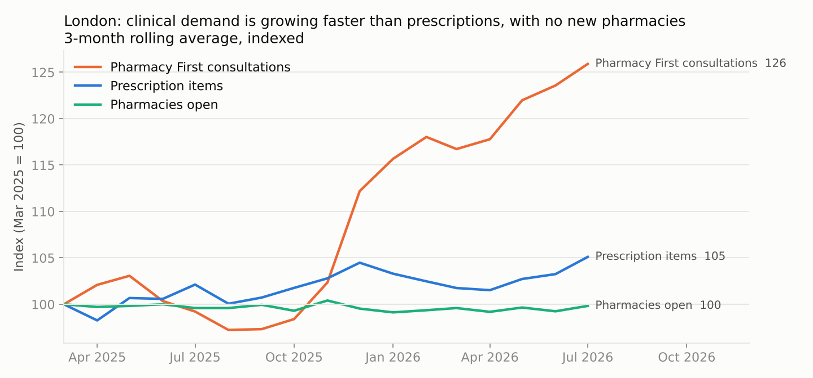
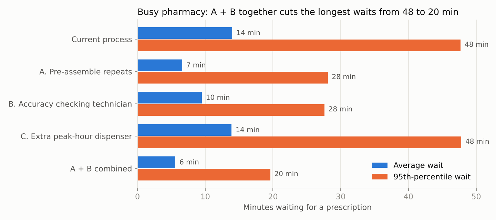

# Healthcare Operations Analytics: NHS Pharmacy Demand & Workflow

**Clinical demand on London's community pharmacies is rising faster than dispensing, while the number of pharmacies stays flat. A simulation shows which workflow change actually shortens patient waits, and which popular fix does nothing.**

`Python` · `SQL (BigQuery API)` · `pandas` · `SimPy` · `Tableau` · `Process mapping` · `User stories`

---

## The problem

From Jan–Jul 2025 to Jan–Jul 2026, London's ~1,700 community pharmacies delivered:

| | Change |
| --- | ---: |
| Prescription items | **+2.5%** |
| Pharmacy First consultations | **+20.5%** |
| Clinical services per median pharmacy (Jul vs Jul) | **+27%** (142 → 181 a month) |
| Pharmacies open | **+0.1%** (1,714 → 1,716) |



Every consultation needs the same person as prescription checking: the pharmacist. The question is which change best protects patient waiting times.

## Approach

1. **Data.** `src/fetch_nhsbsa.py` pulls 19 months (Jan 2025 – Jul 2026) of the [NHSBSA Pharmacy and appliance contractor dispensing data](https://opendata.nhsbsa.net/dataset/pharmacy-and-appliance-contractor-dispensing-data) through the portal's SQL API. The data is aggregated on the server, so 19 files of about 50 MB each come back as two small tables: London pharmacy × month, and England ICB × month.
2. **Cleaning.** `src/analyse.py` standardises ICB names (the portal changed its naming in Mar 2026) and maps every month to the current London structure (North Central and North West London ICBs merged on 1 Apr 2026). It also drops months where a pharmacy dispensed nothing, and computes the headline metrics.
3. **Process mapping.** Swimlane maps of the [current and redesigned workflow](docs/process_maps.md).
4. **Simulation.** `src/simulate.py` is a SimPy discrete-event model of one trading day:
   - demand set from the data (median and 90th-percentile pharmacy, plus a year of growth)
   - prescriptions, repeat collections and consultations competing for one pharmacist and the dispensing team
   - 5 scenarios × 3 demand levels × 300 simulated days
5. **Requirements and delivery.** [12 user stories](docs/requirements.md) with acceptance criteria and MoSCoW priorities, a [pilot plan, stakeholder map and RAID log](docs/project_plan.md), and a [two-page business case](docs/business_case.md).
6. **Dashboard.** A Tableau Public dashboard built from `data/processed/london_pharmacy_month.csv` ([build guide](tableau/README.md)).

## Results



Busy London pharmacy (90th percentile: 294 forms and 14 consultations a day):

| Scenario | Avg wait | 95th-pct wait | Pharmacist busy | Forms unfinished at close |
| --- | ---: | ---: | ---: | ---: |
| Current process | 14.0 min | 47.7 min | 99% | 174 |
| A. Pre-assemble repeats | 6.6 min | 28.1 min | 99% | 195 |
| B. Accuracy checking technician | 9.5 min | 27.6 min | 93% | 10 |
| C. Extra peak-hour dispenser | 13.9 min | 47.8 min | 99% | 174 |
| **A + B combined** | **5.6 min** | **19.6 min** | **94%** | **11** |

- **Extra dispenser hours (C) change nothing.** Dispensers aren't the bottleneck; the pharmacist is.
- **An accuracy checking technician (B) creates pharmacist capacity**, and pre-assembling repeats (A) turns it into shorter waits.
- **A + B cuts the 95th-percentile wait by 59%** and nearly clears the end-of-day backlog, with no extra pharmacist.

Full results for all demand levels are in `data/processed/simulation_results.csv`.

## Recommendation

Run a three-month pilot of A + B at one busy branch, measuring real waiting times against the targets in the [business case](docs/business_case.md).

## Run it yourself

```bash
pip install -r requirements.txt
python src/fetch_nhsbsa.py   # ~2 minutes, pulls 19 months via the NHSBSA API
python src/analyse.py        # cleaning + headline metrics
python src/simulate.py       # ~30 seconds, 4,500 simulated days
python src/charts.py         # README charts
```

## Limitations

- Process times and patient behaviour (for example, 55% of forms collected in person) are assumptions, listed in `data/processed/simulation_assumptions.json`. The pilot's first week replaces them with measured times.
- The model covers one pharmacist on duty and ignores lunch breaks, deliveries and phone calls.
- Some service counts change definition over time (for example, emergency contraception was added in late 2025), so service growth is compared July to July.

*Data: NHS Business Services Authority, Pharmacy and appliance contractor dispensing data, Open Government Licence v3.0.*
