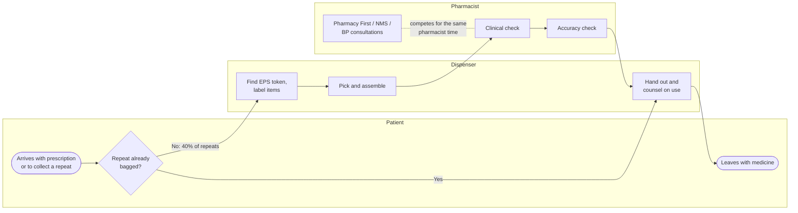
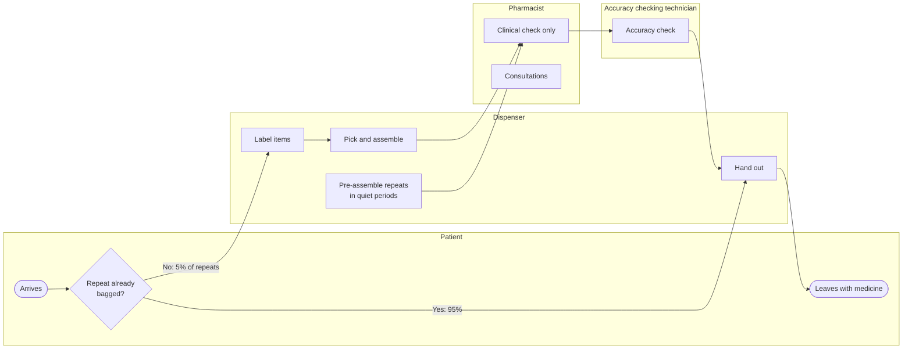

# Process maps

Swimlane maps of how a walk-in prescription moves through a community pharmacy today, and how it moves after the recommended changes (A + B). Each lane is a role.

## Current process (AS-IS)

**Pain points**

1. **The pharmacist is the bottleneck.** They do the clinical check, the accuracy check and every consultation, so at a busy pharmacy they are busy 99% of the day.
2. **Repeats are assembled on demand.** 40% of patients collecting a repeat prescription wait for it to be made up, adding to the queue at peak times.
3. **Consultations and checking compete.** Every Pharmacy First consultation pauses checking, so prescriptions back up behind it.

## Redesigned process (TO-BE: A + B)

**What changes**

- **A. Pre-assemble repeats:** repeat prescriptions arrive by EPS days before collection, so they are made up in quiet periods. 95% are ready when the patient arrives.
- **B. Accuracy checking technician (ACT):** a registered pharmacy technician with accuracy-checking accreditation takes over the final accuracy check. The pharmacist keeps the clinical check, so pharmacist time goes to consultations.
