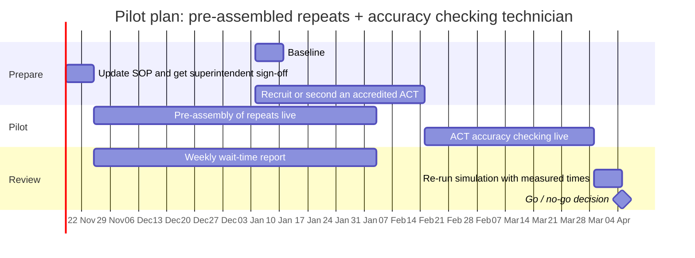

# Project plan

A three-month pilot at one busy branch, then a decision on wider rollout.

## Pilot timeline

## Stakeholder map (power / interest)

| | Low interest | High interest |
| --- | --- | --- |
| **High power** | Area manager, NHS England commissioners (keep satisfied) | Superintendent pharmacist, pharmacy manager (manage closely) |
| **Low power** | Suppliers, head office IT (monitor) | Pharmacists, dispensers, patients (keep informed) |

## RAID log

| Type | Item | Owner | Response |
| --- | --- | --- | --- |
| Risk | ACT accuracy checks increase dispensing errors | Superintendent | Only GPhC-registered pharmacy technicians with ACT accreditation; pharmacist clinical check is never removed; error log reviewed monthly |
| Risk | Pre-assembled repeats are not collected, tying up stock | Manager | 14-day uncollected flag (user story 8) |
| Risk | Simulation assumptions don't match a real branch | Analyst | Time 50 real prescriptions at a pilot branch and re-run the model with measured times |
| Assumption | 55% of prescription forms are collected in person; 25% of those are new prescriptions waited for | Analyst | Validate during pilot |
| Assumption | One pharmacist on duty during all opening hours | Manager | Confirm against branch rota |
| Issue | London ICBs restructured on 1 Apr 2026, breaking trends by ICB | Analyst | Mapped all months to the current four-ICB structure |
| Dependency | Patient medication record system must record who did each check | IT | Confirm with system supplier before go-live |
